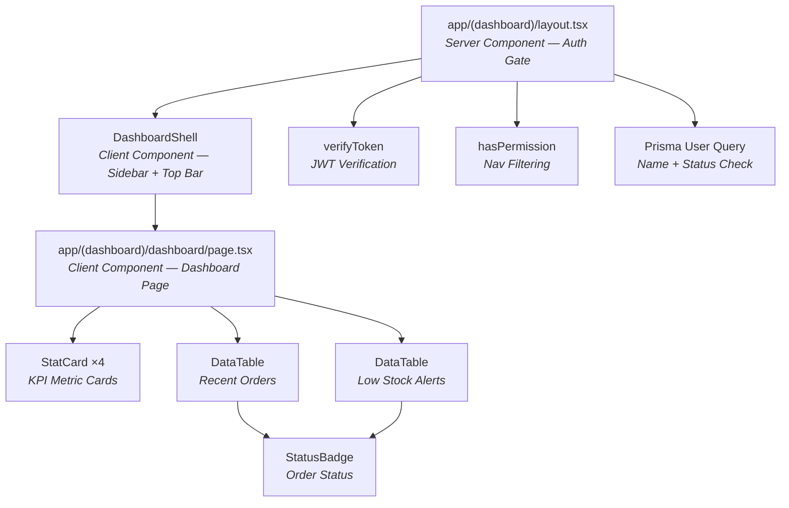
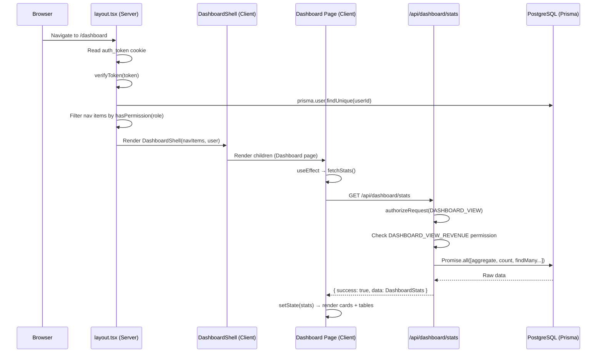

# Dashboard — Feature Documentation

> **Last updated:** 2026-10-23  
> **Module owner:** `app/(dashboard)/dashboard/`  
> **Status:** Production-ready

---

## Table of Contents

- [1. Overview](#1-overview)
- [2. Architecture & Approach](#2-architecture--approach)
- [3. Component Map](#3-component-map)
- [4. File Structure](#4-file-structure)
- [5. Data Flow](#5-data-flow)
- [6. API Reference — `GET /api/dashboard/stats`](#6-api-reference--get-apidashboardstats)
- [7. Authentication & Authorization](#7-authentication--authorization)
- [8. Role-Based Visibility Matrix](#8-role-based-visibility-matrix)
- [9. Database Models Involved](#9-database-models-involved)
- [10. UI Sections Breakdown](#10-ui-sections-breakdown)
- [11. Loading & Error States](#11-loading--error-states)
- [12. Future Improvements](#12-future-improvements)

---

## 1. Overview

The **Dashboard** is the landing page for all authenticated users inside the `(dashboard)` route group. It provides a real-time overview of the business through:

- **KPI stat cards** — Revenue, Orders Today, Low Stock Alerts, Total Orders
- **Recent Orders table** — The 5 most recent orders with status badges
- **Low Stock Alerts table** — Top 10 inventory items at or below reorder threshold

The page is fully responsive (mobile ↔ desktop), supports dark mode, and adapts its visible widgets based on the authenticated user's role permissions.

---

## 2. Architecture & Approach

| Aspect | Approach |
|---|---|
| **Routing** | Next.js App Router with route groups — `app/(dashboard)/dashboard/page.tsx` |
| **Rendering** | Client Component (`"use client"`) for interactive refresh; layout is a **Server Component** for auth gating |
| **Data Fetching** | Client-side `fetch()` to a Route Handler (`/api/dashboard/stats`) on mount + manual refresh |
| **State Management** | Local `useState` (`stats`, `loading`); no external stores needed for this page |
| **Auth Gate** | Server-side in `layout.tsx` — JWT cookie verification → Prisma user lookup → redirect on failure |
| **Permission Model** | Declarative `Permission` constants + `hasPermission(role, perm)` lookup against `ROLE_PERMISSIONS` sets |
| **Styling** | Tailwind CSS utility classes with dark-mode variants (`dark:`) — no custom CSS files |
| **Icons** | `lucide-react` icon library throughout |
| **Layout Shell** | `DashboardShell` — shared sidebar + top bar wrapping all `(dashboard)` child routes |

### Why Client-Side Fetch?

The dashboard page uses client-side fetching (`useEffect` + `fetch`) instead of Server Components for data because:

1. **Manual Refresh** — Users can click the "Refresh" button to re-fetch without a full page reload.
2. **Loading Skeleton** — The shimmer/pulse animations require client-side state transitions.
3. **Future Polling** — The architecture supports adding auto-refresh intervals with minimal changes.

---

## 3. Component Map



### Component Details

| Component | File | Type | Purpose |
|---|---|---|---|
| **Dashboard Layout** | `app/(dashboard)/layout.tsx` | Server Component | Auth gate, user data hydration, permission-based nav filtering |
| **DashboardShell** | `components/DashboardShell.tsx` | Client Component | Collapsible sidebar, top header bar, mobile overlay, user avatar, logout |
| **Dashboard Page** | `app/(dashboard)/dashboard/page.tsx` | Client Component | Main dashboard view with KPIs, tables, and refresh |
| **StatCard** | `components/ui/StatCard.tsx` | Client Component | Reusable KPI card with icon, value, trend badge, loading skeleton |
| **DataTable** | `components/ui/DataTable.tsx` | Client Component | Generic typed table with custom cell renderers and optional pagination |
| **StatusBadge** | `components/ui/StatusBadge.tsx` | Client Component | Semantic status pill (success/error/warning/info) with icon |
| **Can** | `components/Can.tsx` | Client Component | Declarative client-side permission wrapper (UI convenience) |
| **Stats Route Handler** | `app/api/dashboard/stats/route.ts` | Server (Route Handler) | Aggregates dashboard data from Prisma, enforces `DASHBOARD_VIEW` |

---

## 4. File Structure

```
stockpilot/
├── app/
│   ├── (dashboard)/
│   │   ├── layout.tsx              ← Auth gate + DashboardShell wrapper
│   │   └── dashboard/
│   │       └── page.tsx            ← Dashboard page (this feature)
│   └── api/
│       └── dashboard/
│           └── stats/
│               └── route.ts        ← GET endpoint for dashboard data
├── components/
│   ├── DashboardShell.tsx          ← Sidebar + top bar shell
│   ├── Can.tsx                     ← Client-side permission guard
│   └── ui/
│       ├── StatCard.tsx            ← KPI card component
│       ├── DataTable.tsx           ← Generic data table
│       └── StatusBadge.tsx         ← Semantic status badge
└── lib/
    ├── auth/
    │   ├── jwt.ts                  ← Token generation & verification
    │   └── permissions.ts          ← Permission constants & role matrix
    ├── db/
    │   └── db.ts                   ← Prisma client singleton
    └── helpers/
        └── auth-guard.ts           ← authenticateRequest / authorizeRequest helpers
```

---

## 5. Data Flow



### Step-by-Step

1. **Browser** navigates to `/dashboard`.
2. **`layout.tsx`** (Server Component) reads the `auth_token` cookie, verifies the JWT via `verifyToken()`, and queries the database for user name and status.
3. If the user is missing, the token is invalid, or the account is suspended → `redirect("/login")`.
4. The layout filters `ALL_NAV_ITEMS` through `hasPermission(role, item.permission)` to build the visible nav.
5. **`DashboardShell`** renders the sidebar + top bar and passes `children` through.
6. **`page.tsx`** mounts and calls `fetchStats()` inside `useEffect`.
7. The **Route Handler** at `/api/dashboard/stats` re-authenticates the request via `authorizeRequest(Permission.DASHBOARD_VIEW)` and conditionally checks `DASHBOARD_VIEW_REVENUE`.
8. Six parallel Prisma queries run via `Promise.all()` and the aggregated response is returned.
9. The page updates local state and renders KPI cards + data tables.

---

## 6. API Reference — `GET /api/dashboard/stats`

**File:** `app/api/dashboard/stats/route.ts`  
**Auth:** Requires `dashboard:view` permission  
**Caching:** `dynamic = "force-dynamic"` (no caching — always fresh)

### Response Schema

```typescript
// Success (200)
{
  success: true,
  data: {
    totalRevenue?: number,     // Only present for Admin/Manager
    ordersToday: number,
    totalOrders: number,
    lowStockCount: number,
    recentOrders: RecentOrder[],
    lowStockItems: LowStockItem[]
  }
}

// Error (401 | 403 | 500)
{
  success: false,
  error: string
}
```

### Query Breakdown

| # | Query | Prisma Method | Condition |
|---|---|---|---|
| 1 | Total Revenue | `order.aggregate({ _sum: totalAmount })` | `paymentStatus = "Success"` — only if `DASHBOARD_VIEW_REVENUE` |
| 2 | Orders Today | `order.count()` | `createdAt >= todayStart` |
| 3 | Total Orders | `order.count()` | None |
| 4 | Low Stock Count | `inventory.count()` | `quantityOnHand = 0` OR `quantityOnHand ≤ 10` |
| 5 | Recent Orders | `order.findMany({ take: 5 })` | Ordered by `createdAt desc` |
| 6 | Low Stock Items | `inventory.findMany({ take: 10 })` | Same as #4, ordered by `quantityOnHand asc`, includes `product` + `warehouse` relations |

---

## 7. Authentication & Authorization

### Auth Flow (Layout — Server-Side)

```
Cookie: auth_token
       │
       ▼
  verifyToken(token)  ──► Invalid/Missing → redirect("/login")
       │
       ▼
  prisma.user.findUnique({ id: userId })
       │
       ▼
  User not found OR status ≠ "Active" → redirect("/login")
       │
       ▼
  ✅ Authenticated — build nav + render shell
```

### Auth Flow (API — Route Handler)

```
Cookie: auth_token
       │
       ▼
  authorizeRequest(Permission.DASHBOARD_VIEW)
       │
       ├──► No token     → 401 Unauthorized
       ├──► Bad token    → 401 Invalid or expired session
       ├──► No permission → 403 Insufficient permissions
       │
       ▼
  ✅ Authorized — execute queries
```

### Key Modules

| Module | File | Purpose |
|---|---|---|
| `verifyToken` | `lib/auth/jwt.ts` | Decodes and validates JWT using `jose` library, returns `UserTokenPayload` |
| `generateToken` | `lib/auth/jwt.ts` | Creates a signed JWT with `jsonwebtoken` |
| `authenticateRequest` | `lib/helpers/auth-guard.ts` | Reads cookie → verifies token → returns `[payload, null]` or `[null, 401 Response]` |
| `authorizeRequest` | `lib/helpers/auth-guard.ts` | Extends `authenticateRequest` with permission checks → returns `[payload, null]` or `[null, 403 Response]` |
| `hasPermission` | `lib/auth/permissions.ts` | Pure function: checks if a `Role` has a `PermissionKey` via `ROLE_PERMISSIONS` sets |

---

## 8. Role-Based Visibility Matrix

### Dashboard-Specific Permissions

| Permission Key | Constant | Admin | Manager | Staff |
|---|---|:---:|:---:|:---:|
| `dashboard:view` | `DASHBOARD_VIEW` | ✅ | ✅ | ✅ |
| `dashboard:view:revenue` | `DASHBOARD_VIEW_REVENUE` | ✅ | ✅ | ❌ |

### What Each Role Sees

| UI Element | Admin | Manager | Staff |
|---|:---:|:---:|:---:|
| Revenue StatCard | ✅ | ✅ | ❌ (hidden) |
| Orders Today StatCard | ✅ | ✅ | ✅ |
| Low Stock Alerts StatCard | ✅ | ✅ | ✅ |
| Total Orders StatCard | ✅ | ✅ | ✅ |
| Recent Orders Table | ✅ | ✅ | ✅ |
| Low Stock Alerts Table | ✅ | ✅ | ✅ |

### Sidebar Nav Visibility (Full Matrix)

| Nav Item | Permission Required | Admin | Manager | Staff |
|---|---|:---:|:---:|:---:|
| Dashboard | `dashboard:view` | ✅ | ✅ | ✅ |
| Orders | `order:view` | ✅ | ✅ | ✅ |
| Products | `product:view` | ✅ | ✅ | ✅ |
| Inventory | `inventory:view` | ✅ | ✅ | ✅ |
| Analytics | `analytics:view` | ✅ | ✅ | ❌ |
| Settings | `settings:view` | ✅ | ❌ | ❌ |

---

## 9. Database Models Involved

The dashboard reads from two Prisma models:

### `Order` Model (table: `orders`)

| Field | Type | Dashboard Usage |
|---|---|---|
| `id` | `Int` | Row identifier |
| `orderNumber` | `String` | Displayed in Recent Orders table |
| `customerName` | `String` | Displayed in Recent Orders table |
| `totalAmount` | `Decimal(10,2)` | Aggregated for revenue, shown per order |
| `orderStatus` | `OrderStatus` enum | Rendered as StatusBadge |
| `paymentStatus` | `PaymentStatus` enum | Filtered for revenue (`Success` only) |
| `createdAt` | `DateTime` | Filtered for "today" count, shown as formatted date |

### `Inventory` Model (table: `inventory`)

| Field | Type | Dashboard Usage |
|---|---|---|
| `id` | `Int` | Row identifier |
| `quantityOnHand` | `Int` | Low stock threshold check (≤ 10 or = 0) |
| `reorderLevel` | `Int` | Displayed as "Reorder At" column |
| `product` | Relation → `Product` | Displays `name` and `sku` |
| `warehouse` | Relation → `Warehouse` | Displays warehouse `name` |

### Related Enums

```
OrderStatus:   Pending | Processing | Shipped | Delivered | Cancelled
PaymentStatus: Pending | Success | Failed | Refunded
Role:          Admin | Manager | Staff
```

---

## 10. UI Sections Breakdown

### 10.1 Header Bar

- **Welcome message** — Static greeting with subtitle
- **Refresh button** — Triggers `fetchStats()`, shows spinning icon while loading

### 10.2 KPI Grid (`StatCard` ×4)

Rendered in a responsive grid: `1 col (mobile)` → `2 cols (sm)` → `4 cols (lg)`

| Card | Icon | Value Source | Trend | Conditional |
|---|---|---|---|---|
| Total Revenue | `DollarSign` | `stats.totalRevenue` | — | Only shown if `DASHBOARD_VIEW_REVENUE` |
| Orders Today | `ShoppingCart` | `stats.ordersToday` | `"{totalOrders} total"` (neutral) | Always |
| Low Stock Alerts | `AlertTriangle` | `stats.lowStockCount` | "Needs attention" (down) or "All good" (up) | Always |
| Total Orders | `Package` | `stats.totalOrders` | — | Always |

### 10.3 Recent Orders Table

- **Columns:** Order #, Customer, Amount (₹ formatted), Status (badge), Date (localized)
- **Data:** Latest 5 orders, sorted by `createdAt desc`
- **Link:** "View all →" navigates to `/orders`

### 10.4 Low Stock Alerts Table

- **Columns:** Product (name + SKU), Warehouse, Stock (badge — red for 0, yellow for >0), Reorder At
- **Data:** Top 10 items where `quantityOnHand ≤ 10`, sorted ascending
- **Link:** "View inventory →" navigates to `/inventory`

---

## 11. Loading & Error States

| State | Behavior |
|---|---|
| **Initial Load** | `StatCard` renders pulse/shimmer skeletons; tables show 3 shimmer rows |
| **Refresh** | Same skeleton animation; Refresh button is disabled with spinning `RefreshCw` icon |
| **API Error** | Caught silently (`console.error`); cards show fallback `0` / `"..."` values |
| **Empty Data** | `DataTable` renders "No data available" centered message |
| **Unauthenticated** | Redirected to `/login` at layout level (server-side) |
| **Forbidden** | API returns `403`; page shows stale/empty state (no explicit error UI yet) |

---

## 12. Future Improvements

- [ ] **React Query Integration** — Replace raw `fetch` + `useState` with `useQuery` for automatic caching, refetching, and stale-while-revalidate behavior
- [ ] **Auto-Refresh Polling** — Add configurable polling interval (e.g., every 60s) for live dashboard
- [ ] **Redis Read-Through Cache** — Cache the stats response at the API layer with short TTL
- [ ] **Charts / Sparklines** — Add visual trend charts (revenue over time, orders by status)
- [ ] **Error Toast Notifications** — Surface API failures to the user instead of silent console errors
- [ ] **Zod Response Validation** — Validate the API response shape on the client side
- [ ] **Skeleton for Revenue Card** — Handle the conditional revenue card skeleton more gracefully when permission is unknown during loading
